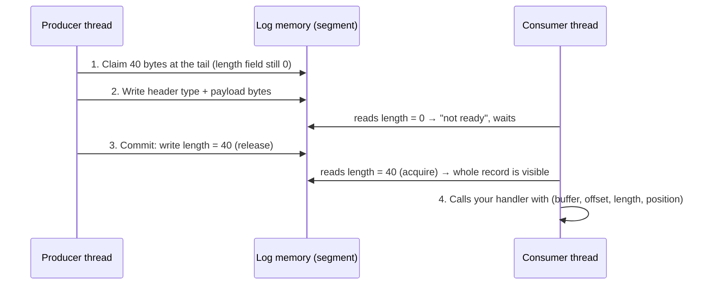

# How Wally works (and the Java behind it)

This page explains what Wally will do, follows one record from start to finish, then goes through each Java concept Wally relies on and shows where it appears in the real code.

If a word is unfamiliar, check the [Glossary](glossary.md).

## What Wally will do

| Capability | What it means for you | Status |
|---|---|---|
| Append records | Write chunks of bytes to the end of the log, from one or many threads | ✅ single segment, single writer (M0) |
| Zero-copy writes | Reserve space and write directly into the log | ✅ (M0) |
| Read records in order | Get every record, in order, through a callback | ✅ (M0) |
| No GC pressure | No objects created per record once warmed up | ✅ proven (M0) |
| Store in files | Records live in memory-mapped segment files; the log grows across files | M1 |
| Checksums | Detect corrupted records | M1 |
| Many producers | Several threads append at once without locks | M2 |
| Durability control | Choose how often data is forced to disk | M3 |
| Crash recovery | Restart after a crash with a correct, uncorrupted log | M3 |
| Named consumers | Readers that remember their place across restarts | M4 |
| Automatic cleanup | Delete old files once everyone has read them | M4 |

## The life of a record



1. **Claim.** The producer reserves space at the end of the log. Nobody else can get that space.
2. **Write.** The producer fills in the record: either Wally copies your bytes in, or you write them yourself (zero-copy).
3. **Commit.** The producer writes the record's length last. This single write is what makes the record "exist" for readers.
4. **Read.** The consumer sees a non-zero length, reads the record, and moves on to the next one, which starts at the next multiple of 8 bytes.

Here is how a record is laid out in memory:

```
byte:  0         4        6        8         12        16
       ┌─────────┬────────┬────────┬─────────┬─────────┬───────────────┬───────┐
       │ length  │ type   │ flags  │ crc32c  │reserved │ payload       │ pad   │
       │ int     │ short  │ short  │ int     │ int     │ (your bytes)  │ 0–7 B │
       └─────────┴────────┴────────┴─────────┴─────────┴───────────────┴───────┘
       ◄──────────────── 16-byte header ──────────────►
```

## Java concepts, and how Wally uses them

### 1. The heap, objects and garbage collection

**The concept.** In Java, `new Order()` creates an object on the **heap**. You never free it yourself. When nothing refers to it anymore, the **garbage collector (GC)** reclaims the memory. That's convenient, but the GC has to find and clean up dead objects, and parts of that work can pause your program.

**Why it matters for Wally.** A typical queue creates at least one object per message. At 10 million messages per second, that's 10 million objects per second for the GC to deal with.

**What Wally does.** It keeps record data *outside* the heap and creates no objects per record. The [benchmarks](benchmarks.md) show the difference: `ArrayBlockingQueue` allocates 48 bytes per 32-byte message; Wally allocates about 0.

### 2. Off-heap memory: `Arena` and `MemorySegment`

**The concept.** Java's [FFM API](glossary.md#ffm-api-foreign-function-memory-api) (final in Java 22) lets you work with raw memory safely:

- An **`Arena`** owns some memory and decides when it's freed.
- A **`MemorySegment`** is a handle to that memory. It knows its size, so reading past the end throws an exception instead of corrupting memory.
- A **`ValueLayout`** (`JAVA_INT`, `JAVA_LONG`, `JAVA_SHORT`...) says how to read or write a value at an offset.

```java
MemorySegment buffer = Arena.ofAuto().allocate(1 << 20, 4096);  // 1 MB, page-aligned, zero-filled
buffer.set(ValueLayout.JAVA_LONG, 16, 42L);                     // write a long at byte 16
long value = buffer.get(ValueLayout.JAVA_LONG, 16);             // read it back
```

**In Wally.** `SegmentWriter` and `SegmentReader` work entirely on a `MemorySegment`. For example, writing the record type in `SegmentWriter.tryClaim`:

```java
buffer.set(ValueLayout.JAVA_SHORT, offset + TYPE_OFFSET, RecordFormat.TYPE_DATA);
```

Before the FFM API, libraries like this used `sun.misc.Unsafe`, an internal class that was never officially supported and is now being removed. See [ADR 0001](adr/0001-ffm-over-unsafe.md).

### 3. Memory-mapped files (coming in M1)

**The concept.** `FileChannel.map(...)` asks the operating system to make a file appear as memory. Writing to the returned `MemorySegment` writes to the file. The OS moves data to disk in the background, and `segment.force()` makes it happen right now.

```java
try (FileChannel channel = FileChannel.open(path, READ, WRITE, CREATE)) {
    MemorySegment file = channel.map(FileChannel.MapMode.READ_WRITE, 0, size, arena);
    // file is now a MemorySegment backed by the file on disk
}
```

**In Wally.** The same `SegmentWriter` and `SegmentReader` code works unchanged on a mapped file, because both are just `MemorySegment`s. Closing the arena unmaps the file immediately. The older `MappedByteBuffer` API had no way to do that.

### 4. Threads and the Java Memory Model

**The concept.** A **thread** is an independent path of execution. Threads share memory, which creates a surprising problem: to go faster, the CPU and the compiler may *reorder* memory writes. If thread A writes the payload and then the length, thread B might see the new length before the payload.

The **Java Memory Model** defines when one thread is guaranteed to see another's writes. The key idea is **happens-before**: if thread A does a *release* write and thread B sees it with an *acquire* read, everything A wrote before the release is visible to B.

**In Wally.** This is exactly the "write the record, then sign it" rule. Commit is a release write of the length (`RecordFormat.publish`):

```java
public static void publish(MemorySegment buffer, long frameOffset, int frameLength) {
    Mem.setIntRelease(buffer, frameOffset + FRAME_LENGTH_OFFSET, frameLength);
}
```

And the reader starts every record with an acquire read (`SegmentReader.read`):

```java
int frameLength = Mem.getIntAcquire(buffer, offset);
if (frameLength == 0) {
    break;   // not committed yet: stop here and try again later
}
```

The test `readerOnOtherThreadSeesEveryRecordInOrder` writes 1 million records on one thread and checks that another thread reads every one, in order.

### 5. `VarHandle`: ordered and atomic memory access

**The concept.** A `VarHandle` is Java's tool for reading and writing memory with special rules: plain, acquire, release, volatile, or atomic operations like `getAndAdd` and `compareAndSet`. The FFM API can give you a `VarHandle` for any `ValueLayout`.

**In Wally.** The `Mem` class keeps one `VarHandle` per type and wraps it in clearly named methods:

```java
private static final VarHandle INT = ValueLayout.JAVA_INT.varHandle();

public static int getIntAcquire(MemorySegment segment, long offset) {
    return (int) INT.getAcquire(segment, offset);
}

public static long getAndAddLong(MemorySegment segment, long offset, long delta) {
    return (long) LONG.getAndAdd(segment, offset, delta);
}
```

`getAndAddLong` will hand out space to multiple producers in M2. It's the "deli counter ticket" from the home page: each producer adds its record size to the tail and gets back where its own slot starts, in a single CPU instruction, with no lock.

!!! note "Why `(int)` casts?"
    `VarHandle` methods are *signature polymorphic*: the JVM uses the exact argument and return types you write to pick a fast path. The cast tells it the return type, and `static final` lets the JIT compiler turn the call into a single machine instruction.

### 6. Interfaces and lambdas, without allocation

**The concept.** An **interface** declares methods without implementing them. A **functional interface** has exactly one method, so you can pass a **lambda** (a short inline function) wherever one is expected.

**In Wally.** Reading uses a callback, so Wally never has to create an object per record to hand it to you:

```java
@FunctionalInterface
public interface RecordHandler {
    void onRecord(MemorySegment buffer, long offset, int length, long position);
}
```

```java
reader.read((buffer, offset, length, position) -> {
    long orderId = buffer.get(ValueLayout.JAVA_LONG, offset);
    // ...
}, 100);
```

!!! warning "Lambdas can allocate"
    A lambda that uses local variables from around it (a *capturing* lambda) may create a new object every time that line runs. To stay zero-allocation, create your handler once and reuse it, or make your class implement `RecordHandler`, as the test helper `AllocationLoop` does.

### 7. The flyweight pattern: reusing one object

**The concept.** Instead of creating an object for every piece of data, keep one object and point it at different data each time.

**In Wally.** `SegmentWriter` itself implements the `Claim` interface. After `tryClaim`, the same writer object describes the claimed space:

```java
long position = writer.tryClaim(8);
writer.buffer().set(ValueLayout.JAVA_LONG, writer.offset(), 42L);  // write directly into the log
writer.commit();
```

One object serves every record, so there is nothing for the GC to collect.

### 8. Return codes instead of exceptions on the hot path

**The concept.** Java exceptions are great for real errors, but creating one captures a stack trace, which allocates memory and is slow.

**In Wally.** An expected situation, like "the segment is full", is reported with a return value:

```java
if (writer.append(src, 0, 64) == SegmentWriter.NO_SPACE) {
    // move to the next segment (M1 does this for you)
}
```

Programming mistakes, like a negative length or committing twice, still throw exceptions, because they should never happen in correct code.

### 9. `try` / `finally` for consistent state

**The concept.** A `finally` block always runs, even if an exception is thrown.

**In Wally.** If your handler throws, the reader still saves how far it got, so the failing record isn't delivered again in an endless loop:

```java
try {
    while (count < recordLimit && offset < limit) { /* deliver records */ }
} finally {
    this.offset = offset;
}
```

### 10. Java modules (`module-info.java`)

**The concept.** A module declares which packages other code may use.

**In Wally.**

```java
module io.wally.core {
    exports io.wally.api;
}
```

Only `io.wally.api` is visible to users. Everything under `io.wally.internal` can change freely without breaking anyone.

### 11. Proving it: measuring allocation

How do we *know* Wally doesn't allocate? Three independent checks:

| Check | How it works | Where |
|---|---|---|
| Per-thread counter | `ThreadMXBean.getCurrentThreadAllocatedBytes()` before and after 1M records; must be under 1 KB | `ZeroAllocationTest` |
| Epsilon GC | Runs 50M records with a GC that never frees memory and a 128 MB heap. Any per-record allocation would run out of memory | `./gradlew :wally-core:epsilonTest` |
| JMH profiler | Reports bytes allocated per operation: ≈ 0.0001 | `./gradlew :wally-bench:jmh -Pjmh.profilers=gc` |

## Code map

| File | Role |
|---|---|
| `api/RecordHandler.java` | Callback you implement to receive records |
| `api/Claim.java` | Reserved space you write into, then commit or abort |
| `internal/memory/Mem.java` | Acquire/release and atomic reads/writes on off-heap memory |
| `internal/memory/Align.java` | Rounding up to multiples of 8 |
| `internal/log/RecordFormat.java` | Record header layout, publish and padding helpers |
| `internal/log/SegmentWriter.java` | Appends records to one segment; doubles as the `Claim` |
| `internal/log/SegmentReader.java` | Reads committed records from one segment |
