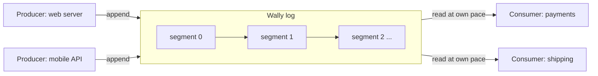

# Wally

**Wally is a Java library that lets a program write down events very quickly, never lose them, and hand them to other parts of the program in order.**

!!! tip "New here?"
    You don't need to be a Java expert to follow these docs. Words that might be new are linked to the [Glossary](glossary.md). For the Java side of things, read [How Wally works](how-it-works.md).

## The problem

Imagine an online shop on a busy sale day. Thousands of orders arrive every second. The shop has two needs:

1. **Never lose an order.** If the server crashes, every order it already said "OK" to must still be there when it restarts.
2. **Hand orders to workers fast.** Different parts of the system (payment, shipping, email) each need to see every order, in the order it arrived, without slowing each other down.

The usual Java tools for passing messages between parts of a program (called [queues](glossary.md#queue)) work, but at very high speeds they hit two problems:

- **Waiting in line.** Only one [thread](glossary.md#thread) can use the queue at a time, so the others wait. This is called [lock](glossary.md#lock) contention.
- **Cleanup pauses.** Every message creates a new Java object. Java periodically pauses the program to clean up old objects ([garbage collection](glossary.md#garbage-collection-gc)). Those pauses can be milliseconds long, which is a lifetime for a system handling millions of events.

Wally is built to avoid both.

## What Wally does

Wally does two jobs with one data structure.

=== "Job 1: a logbook (Write-Ahead Log)"

    Think of a ship's logbook written in pen. Every event is written on the next free line, in order, and never erased or changed. If something goes wrong, you can read the logbook from the start and know exactly what happened.

    Databases use this trick: before changing anything, they write what they are about to do into a log. After a crash, they replay the log. This is a [Write-Ahead Log (WAL)](glossary.md#write-ahead-log-wal).

=== "Job 2: an order rail (Event Queue)"

    Think of a restaurant kitchen. Waiters pin order tickets on a rail, left to right. Each cook reads the tickets in order and keeps a bookmark showing how far they've got. The grill cook and the dessert cook read the same tickets, at their own pace.

    In Wally, waiters are [producers](glossary.md#producer), cooks are [consumers](glossary.md#consumer), and bookmarks are [cursors](glossary.md#cursor). That makes Wally an [event queue](glossary.md#event-queue).

Because both jobs are "write events in order, read them in order", Wally uses **one** log for both. The only difference is when old pages get thrown away.



## How Wally does it

Five ideas, in plain language. [How Wally works](how-it-works.md) explains each one with the actual Java code.

**1. One long notebook, split into pages.**
Events are appended one after another into fixed-size files called [segments](glossary.md#segment). When a page fills up, Wally starts the next one. Every event gets a [position](glossary.md#position): its distance in bytes from the very start of the log, like a page-and-line number.

**2. Write straight into a file's memory.**
Wally uses [memory-mapped files](glossary.md#memory-mapped-file). The operating system makes a file look like a block of memory, so writing to that memory *is* writing to the file. There is no separate "save" step for every event, and the operating system writes it to disk in the background.

**3. Work outside Java's cleanup zone.**
Normal Java objects live on the [heap](glossary.md#heap), which the garbage collector manages. Wally keeps events [off-heap](glossary.md#off-heap) in raw memory and reuses the few objects it needs. No new objects per event means nothing for the garbage collector to clean, so there are no cleanup pauses. This is what [zero-allocation](glossary.md#zero-allocation) means.

**4. No waiting in line.**
Instead of a lock, producers take a ticket, like at a deli counter. One tiny [atomic](glossary.md#atomic-operation) instruction hands each producer its own slot in the log, and they all write at the same time without blocking each other. This is called [lock-free](glossary.md#lock-free).

**5. Write the record, then sign it.**
A reader must never see a half-written event. So a producer writes the event first and writes its length last, like signing a form only after filling it in. A reader that sees a length of zero knows "not finished yet, wait here." Java's [memory ordering](glossary.md#acquire-release) rules guarantee that once the length is visible, the whole event is too.

## What using it will look like

!!! note "Coming in milestone M1"
    The public API below is being built. Today, the lower-level building blocks exist and are tested. See the [Roadmap](roadmap.md).

```java
try (Wally wal = Wally.builder().dir(Path.of("data/orders")).open()) {

    // Producer side: write an event
    Appender appender = wal.appender();
    appender.append(orderBytes, 0, orderBytes.length);

    // Consumer side: read events in order, at your own pace
    Tailer payments = wal.tailer("payments");
    payments.poll((buffer, offset, length, position) -> {
        // handle one order here
    }, 100);
}
```

## Where to go next

| If you are... | Start with |
|---|---|
| New to software engineering | [Glossary](glossary.md), then [How Wally works](how-it-works.md) |
| New to Java, comfortable with programming | [How Wally works](how-it-works.md) |
| An experienced Java developer | [Concepts](concepts.md), [Blueprint](design/blueprint.md), [File format](format.md) |
| Interested in contributing | [Roadmap](roadmap.md), [ADRs](adr/0001-ffm-over-unsafe.md), [Benchmarks](benchmarks.md) |

!!! warning "Status"
    Pre-alpha. Milestone M0 (off-heap memory layer and single-segment log) is done. See the [Roadmap](roadmap.md).
