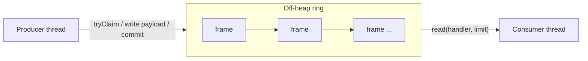

# Wally

**Wally is a bounded, lock-free, zero-allocation single-producer/single-consumer (SPSC) ring buffer for the JVM, built on the Foreign Function & Memory API.**

One thread writes variable-length messages into an off-heap ring; one other thread reads them in order. There are no locks, no CAS loops, and no objects created per message.



## How it works

- **Off-heap memory.** The ring and its two cursors live in one `MemorySegment`, outside the garbage-collected heap.
- **Claim, write, commit.** The producer claims space for a frame, writes the payload directly into the ring, then publishes it with a single release store of the tail. The consumer reads the tail with an acquire load, so a frame it can see is always complete.
- **Variable-length frames.** Each frame is an 8-byte header (length) plus the payload, padded to 8 bytes. A length of 0 marks a wrap to the start of the ring.
- **Explicit backpressure.** `tryClaim` returns `false` when the ring is full; the producer decides whether to spin, drop or slow down.
- **No false sharing.** The head and tail cursors are 128 bytes apart off-heap, and the writer's and reader's private state is padded on-heap.

The [implementation notes](implementation.md) cover the protocol in detail, including the wrap-sentinel ordering.

## Example

```java
RingBuffer ring = new RingBuffer(new RingBufferConfig().capacity(1 << 20));
Writer writer = ring.writer();   // producer thread only
Reader reader = ring.reader();   // consumer thread only

// Producer
if (writer.tryClaim(8)) {
    writer.buffer().set(ValueLayout.JAVA_LONG, writer.offset(), 42L);
    writer.commit();
}

// Consumer
reader.read((buf, off, len, pos) -> {
    long value = buf.get(ValueLayout.JAVA_LONG, off);
}, 100);
```

## Where to go next

| If you want to... | Read |
|---|---|
| Use it | [Quick start](quickstart.md) |
| Understand the protocol | [Implementation](implementation.md) |
| See measured performance | [Benchmarks](benchmarks.md) |
| See the design decisions | [ADRs](adr/0001-ffm-over-unsafe.md) |
